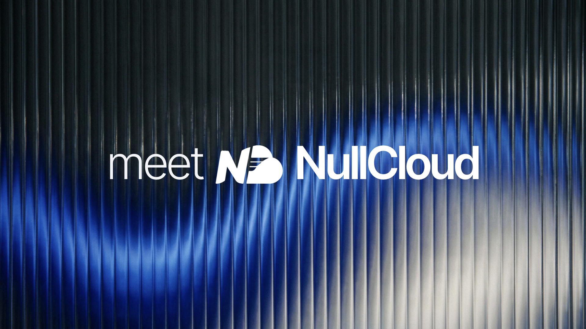

  

## One hosting provider. No issues.

We’re a small team focused on infrastructure, driven by one frustration: hosting has been unnecessarily painful for too long.

We’ve run servers, scaled projects, and dealt with the same problems everyone else has—slow support, unclear outages, and providers that treat reliability as optional. At some point, “that’s just how it is” stopped being acceptable. So we built something better. Not feature-heavy for the sake of it, but practical, fast, and predictable where it matters: uptime, performance, and support that actually responds like humans.

If you’re done settling for inconsistent hosting and want infrastructure that feels built with care instead of corners cut, you’re in the right place.

## Get in touch with us
Questions, ideas or something broken: [support@nullcloud.co.uk](mailto:support@nullcloud.co.uk).
NullCloud's parent company is [Stacklayer Communications Ltd](https://stacklayer.host), registered in England and Wales.
